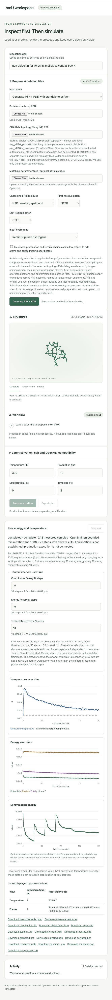

# Protein simulation workspace

The agreed product design, specification, and interactive preview are in [outputs/README.md](outputs/README.md).

## Preview



Current local interface with measured ubiquitin periodic-water traces from the 2 ps NVT test · updated November 7, 2026. This preview is refreshed with interface changes.

## Run locally

Requires Python 3.10 or newer. Existing PSF/PDB uploads and planning use the standard library. Generation uses the standalone Python `psfgen` library in the backend; VMD and Tcl are not required.

An official standalone psfgen 2.x executable can be selected instead of the legacy Python library:

```sh
python3 -m molvis --psfgen /absolute/path/to/NAMD/psfgen
```

Alternatively set `MOLVIS_PSFGEN` to that executable path before starting the server. This route uses the psfgen executable shipped with NAMD; it does not start NAMD dynamics or require VMD. Obtain the official package separately from UIUC. The executable must be approved to run by your operating system. The app does not change OS security settings. The adapter requires psfgen 2.0+, records the reported version and executable hash, and rejects engine errors even if the process exits with status zero. Only controlled filenames and validated preparation choices enter its Tcl script. Without this option, the existing Python-library backend remains selected.

The official NAMD 3.0.3 Mac package's psfgen 2.0 executable was verified with our ubiquitin example. To launch that local configuration again:

```sh
python3 -m molvis --port 8766 --psfgen "$HOME/Downloads/NAMD_3.0.3_MacOS-universal-multicore/psfgen"
```

The complete 30-test suite passes with this executable and with the legacy library backend. The official executable removes the AUTO/PATCH parser diagnostic for the supplied CHARMM36 topology. CTER terminal O/OXT naming is now handled by the mapping described below; passing preparation tests does not imply simulation readiness.

```sh
python3 -m molvis
```

Open http://127.0.0.1:8765. Prepare the files using one of the two routes below, then edit the settings and select **Propose workflow**. The viewer projects actual Cα coordinates and supports drag rotation and scroll zoom. Export saves the proposed configuration, file hashes, prepared PDB/PSF text, steps, and preparation record as JSON.

## Prepare files before planning

**Starting topology: CHARMM36 protein file `top_all36_prot.rtf`.** Select your local copy in the topology uploader. Our local distribution pairs it with the CHARMM36m protein parameters `par_all36m_prot.prm`. Files are supplied by the user, not bundled or downloaded automatically; other compatible topologies can still be selected.

**Protein/lipid file note:** In our CHARMM36 distribution, protein and lipid topologies are separate: `top_all36_prot.rtf` and `top_all36_lipid.rtf`. Protein-only preparation needs just the protein topology. Older distributions provide a combined file such as `top_all27_prot_lipid.inp`, containing CHARMM22 protein and CHARMM27 lipid definitions.

Other compatible CHARMM-format topology files can be uploaded instead, with their corresponding parameter files and appropriate residue aliases/patch choices. The uploaded contents determine the preparation; the filename is not hard-coded. Other force-field families remain possible future choices, but require a compatible preparation/runner path. A PSF contains topology information and does not replace the force-field parameter files required to run a simulation.

- **Generate PSF + PDB:** upload a protein PDB and the matching CHARMM residue topology files (`.rtf`). Review the HIS alias (HSE/HSD/HSP), first/last residue patches (NTER/CTER or NONE), and coordinate-guessing consent. Before psfgen, the backend selects protein residues and writes `protein.pdb`, excluding crystallographic waters, ions and other non-protein components. Existing protein hydrogens are retained. The selection uses standard residue names and peptide-backbone recognition as a conservative approximation of VMD `atomselect top "protein"`; unfamiliar backbone-containing residues are flagged for review rather than silently discarded. The manifest and activity log record retained atom counts and excluded components. Existing PSF/PDB uploads are never filtered. The standalone backend splits chains/segments, maps ILE CD1 to CHARMM CD, builds atoms, assigns coordinates, and writes an X-PLOR PSF and matching PDB. Explicitly named histidine variants are retained. Missing backbone atoms, residue-number gaps, reused TER-separated segment IDs, insertion codes, alternate positions, and nonstandard residues require external resolution. Disulfide/custom patches are not inferred. No solvation or minimization occurs.
- **Upload existing files:** provide the PSF and PDB from the same preparation. Files are retained unchanged. Checks cover atom count, ordered residue/atom identity, segment IDs when present, finite charges/masses and coordinates. Bonded terms and parameter compatibility are not yet validated.

**C-terminal oxygen mapping:** With the `CTER` patch, only the final residue in each segment receives `O → OT1` and `OXT → OT2` naming in the psfgen input. The measured coordinates are preserved and checked after generation. Internal oxygens, `NONE` termini, and uploaded pairs are unchanged. The manifest records each mapping; exact mapped inputs are included under `segments/`. See [the correction note](outputs/terminal-oxygen-mapping.md) for the reason and ubiquitin verification.

Both routes accept optional parameter-file uploads, retained in the downloadable ZIP for the future runner. Download PDB/PSF individually or a preparation bundle containing files, hashes, options, segment mapping, topology/parameter uploads and the engine log when generated. A checked pair is **not** marked simulation-ready. Matching CHARMM parameters, solvent selection and scientific validation remain required; PSF input is never assigned Amber14/OBC2 settings automatically.

For generation, install the backend dependency in an isolated environment (a C compiler is needed to build its extension):

```sh
python3 -m venv .prep-env
.prep-env/bin/python -m pip install -r requirements-preparation.txt
.prep-env/bin/python -m molvis
```

Alternatively use `conda env create -f environment.yml` and `conda run -n molvis python -m molvis`. The source dependency is version/hash pinned. The conda recipe builds from source so it can support platforms without a prebuilt psfgen package. For a separate preparation interpreter, set `MOLVIS_PREP_PYTHON` to its absolute Python path before starting the server. Browser users need no VMD installation; a hosted deployment must install the library on its server.

Generation runs in a temporary scratch directory in an isolated worker process with a 120-second timeout. After a successful pair check, both generation and upload routes persist their files in a unique folder:

```text
mol_vis_sim/runs/preparations/<preparation-id>/
  prepared.pdb
  prepared.psf
  manifest.json
  preparation.zip
  source.pdb          # unmodified original input, for generated pairs
  protein.pdb         # protein selection, with original atom names
  segments/           # exact per-segment psfgen inputs, with terminal naming
  psfgen.log          # for generated pairs
  topologies/        # supplied topology files, for generation
  parameters/        # supplied parameter files, when provided
```

The interface shows the absolute server folder after preparation, and the response and manifest record the paths. Each preparation gets a new ID; earlier outputs are not overwritten. Files survive closing the page or restarting the server. They are excluded from Git and remain until manually removed. **Download PDB**, **Download PSF**, **Download manifest**, and **Download all files (ZIP)** serve the saved files directly, saving additional copies to the browser's configured download location. Download URLs are included in the response/manifest and remain usable while the server is running with the same output root and files are retained. In the current local setup, the server folder is on your computer; in a hosted deployment, it would be on the server.

The default root is `<repository>/runs/preparations`, independent of the launch directory. Set `MOLVIS_OUTPUT_DIR` before starting the server to use a different root. The server must have write access. Results are published only when the complete folder has been saved; a write failure returns an error rather than claiming success. Temporary scratch files are removed after each request. Each input file is limited to 5 MB, the request to 30 MB, and topology/parameter uploads to 12 files of each kind. Topology and parameter data are not executed as scripts. The server remains bound to loopback.

The interface supports preparation, planning and structure inspection. It does not interpret natural-language requests or launch production dynamics; bounded OpenMM readiness tests are available. A separate local diagnostic below checks CHARMM parameter loading and bounded vacuum minimization. Live energy and temperature traces are available for bounded readiness runs; production trajectory controls remain future work. A parsed PDB is not a scientifically validated structure. Multiple models, alternate locations, and duplicate atoms require explicit resolution; non-protein components are retained in existing pairs and flagged for review. mmCIF is not yet supported.

The default request names ubiquitin as an example; it does not identify the uploaded protein. Supply your own ubiquitin PDB to plan that example. Production duration is separate from the optional preparatory equilibration duration. No equilibration is silently added.

## Checks

Generation offers **Retain supplied hydrogens** (the existing default) or **Rebuild with selected topology** (recommended for hydrogen naming mismatches). Rebuilding removes only input H/D/T atoms from the per-segment psfgen input, then psfgen adds hydrogens for the selected topology, protonation and termini. Original `source.pdb` and selected `protein.pdb` remain intact. The manifest records `options.hydrogens` and every removed input atom. Upload mode never changes the supplied pair. API clients can set `options.hydrogens` to `retain` or `rebuild`; the validation command also accepts `--hydrogens rebuild`.

The reproducible two-protein preparation checks and successful VMD comparisons are documented in [the validation report](outputs/preparation-validation.md). Run matched preparations with:

```sh
python3 -m molvis.validation run --psfgen /path/to/psfgen --topology /path/to/top_all36_prot.rtf --case 1UBQ=/path/to/1UBQ.pdb --case 1VII=/path/to/1VII.pdb
```

Add `--vmd /path/to/vmd` to generate and compare actual VMD references. Without it, VMD comparison is explicitly recorded as `not_run`. The command saves local inputs, a VMD reference script, and a JSON report under `work/preparation-validation/`; topology files and generated molecular files remain excluded from Git. The reference script currently supports single-chain proteins with HSE/NTER/CTER settings. To compare reference files generated elsewhere, place them together as `prepared.psf` and `prepared.pdb`, then run `python3 -m molvis.validation compare /path/to/app-output /path/to/reference`.

```sh
python3 -m unittest discover -s tests -v
.prep-env/bin/python -m unittest discover -s tests -v
node --check web/app.js
node tests/test_display_refresh.cjs
```

## Local OpenMM diagnostic

### Live measurements

After preparation and solvent selection, **Run + plot NVT** starts an OpenMM worker in the background. The **Live energy and temperature** panel updates while it runs: minimization potential energy versus optimizer report number, then measured temperature and potential/kinetic/total energy versus simulation time. Dynamics are sampled at the selected step intervals (default 10 steps, or 0.02 ps at 2 fs); the target temperature is a dashed reference line. Temperature is not reported during minimization. Hover over points or use the latest-values table to inspect readings.

**Output intervals** are independent positive whole numbers of simulation steps for coordinates, energy and temperature (default 10 steps each). For a 2 fs integration timestep, every 10 steps means every 20 fs (0.02 ps). Choose intervals before starting; each run records and freezes them. They control actual OpenMM dynamics reports and saved energy/temperature samples, independent of computer speed. The interface shows the corresponding simulated time for each choice. Step 0 is included; minimization remains indexed by optimizer reports because it does not advance simulation time. Unsampled fields are blank in CSV and null in JSONL; plots and latest-value rows use each channel's own timestamps.

New readiness runs capture actual Cα coordinates at step 0 after minimization and every selected coordinate interval. The browser polls for progress and displays the latest available snapshot, so fast runs can produce multiple outputs between screen updates. Only the latest snapshot is retained in the live run record, including after cancellation or restart; this is a lightweight preview, not a saved trajectory. The final PDB remains available separately, even if the final step is not on an output boundary. Earlier saved runs have no coordinate snapshots. Intervals longer than the selected test length yield only the initial output. See [the two-protein stress-test report](outputs/stress-testing.md) for output checks, reconnect behavior, timing results and their limits.

**NVT test length** accepts 1–1,000 integration steps (default 100). At 2 fs, 1,000 steps is 2 ps; this is separate from the proposed production duration. Tests still use the existing 20-iteration-per-pass minimization setting and do not assert convergence or equilibration. Progress reports completed steps, and portable state XML plus a binary checkpoint are saved at step 0 and every 100 steps, including the final partial block.

Live worker files persist under `runs/live/<id>/worker/`, including after cancellation or failure. Available checkpoint, state, System and integrator downloads appear while the job runs; successful environment ZIPs also contain them. Checkpoint loading requires a matching System, OpenMM version, platform and hardware; the app does not automatically resume runs. State XML is more portable but does not retain the random-number-generator state. Interactive compatibility and ≤100-step tests retain a 240-second timeout; longer bounded tests allow `240 + 2 × steps` seconds (2,240 seconds for 1,000 steps).

Runs use a frozen copy of the submitted settings. **Stop run** terminates the worker and retains partial measurements. Refreshing reconnects to the last run; `/?run=<run-id>#live-monitor` opens a saved trace. Interrupted server sessions are labeled and are not automatically resumed. Live CSV/JSONL downloads remain available, including partial traces, and completed environment ZIPs include measurements plus OpenMM's dynamics CSV. Records persist under `runs/live/<id>/`; successful environment artifacts remain in `runs/environments/<id>/`. Only one live readiness run is allowed at a time.

See [the completed 2 ps ubiquitin test](outputs/two-ps-nvt.md) for temperature trends and checkpoint verification. These are real bounded readiness measurements, not an implementation of the proposed full production duration or a declaration of stabilization. See [the live visualization validation](outputs/live-measurements.md).

Solvation and salt default to **Decide later**. After protein preparation and structure review, open **Later: solvation, salt and OpenMM compatibility** to choose an environment. Until then, exported plans leave solvent method, salt and box settings unset and record compatibility as deferred. Select vacuum, implicit OBC2, implicit GBn2, or explicit CHARMM-modified TIP3P, and upload matching CHARMM parameter/topology files to check compatibility. For vacuum and implicit models, an isolated worker actually creates the OpenMM System with HBonds constraints and evaluates finite energy/forces on the CPU. Implicit salt defaults to **0.2 M ionic screening**, not added ions. OpenMM OBC2/GBn2 are generalized Born models, not the exact NAMD GBIS implementation. Explicit CHARMM-modified TIP3P now builds a cubic periodic water box using your local `toppar_water_ions.str`, preserving the supplied protein PSF, types, charges, CMAP terms and coordinates. PME uses a 1.2 nm cutoff and switching from 1.0 nm. Explicit salt is fixed at 0 M, `neutralize=False`, and no Na+, Cl- or counterions are added. Missing files, engine availability, and parameter failures have distinct statuses. Proposing a workflow repeats the check for the submitted settings and stores its result and input hashes in the exported plan. Changed inputs invalidate the displayed check. **Run + plot readiness (100 steps)** additionally performs minimization (20 iterations per optimizer pass; constraint enforcement may restart it), initializes velocities at the selected temperature, and advances 100 NVT steps at the selected timestep. Both compatibility and readiness outputs are saved separately in `runs/environments/<id>/` with direct downloads for the solvated PSF/PDB, serialized System, manifest and ZIP; readiness also saves final coordinates and State XML. This does not run the proposed full production duration. See [water-box and readiness results](outputs/waterbox-readiness.md).

There is no target-pH input. Histidine HSE/HSD/HSP and first/last patches control generation; other amino acids retain the supplied topology's states. This is not automatic pKa prediction, site-specific titration, or protonation validation. Changing protonation choices requires preparing the files again. Uploaded pairs retain their existing chemistry. The server uses `.venv/bin/python` when present for compatibility workers; set `MOLVIS_OPENMM_PYTHON` to select another installed environment. See [the solvent compatibility results](outputs/solvent-compatibility.md).

Install the optional dependency into a separate environment:

```sh
python3 -m venv .venv
.venv/bin/python -m pip install -r requirements-simulation.txt
.venv/bin/python -m molvis.openmm_validation --preparation runs/preparations/PREPARATION_ID --topology /path/to/top_all36_prot.rtf --parameters /path/to/par_all36m_prot.prm --output work/openmm-validation/NEW_RUN
```

This uses OpenMM's [CHARMM PSF and parameter loading workflow](https://docs.openmm.org/latest/userguide/application/02_running_sims.html). The local test uses CHARMM36 protein topology plus CHARMM36m protein parameters; the filenames are recorded explicitly rather than inferred. Supply a compatible alternative topology/parameter set if choosing another force field. Repeat `--topology` or `--parameters` for additional files.

The diagnostic checks PSF/PDB correspondence, creates a fully parameterized System for that input, evaluates finite energies and forces, and attempts at most 200 minimization iterations. Settings are deliberately **vacuum, NoCutoff, no constraints, no restraints, no dynamics** on one CPU thread. It rejects nonfinite values and energy increases, but does not assert convergence or production readiness. Set `--max-iterations` and `--tolerance` explicitly for another bounded check; `--platform Reference` is also supported.

Each new output directory contains `report.json` (settings, input hashes, engine version, energies, forces and heavy-atom displacement), `minimized.pdb`, its matching `prepared.psf`, `system.xml`, and `state.xml`. Inputs are never overwritten, and an existing output folder is rejected. Parameter/minimization errors exit nonzero and save a failure report after input loading. These outputs are separate from preparation downloads. See [the measured results and remaining steps](outputs/openmm-validation.md). To include the optional OpenMM integration tests, run the regression suite with `.venv/bin/python` and a configured `MOLVIS_PSFGEN`.

## Next implementation

Next priorities (November 7, 2026):

1. Initial two-protein stress checks passed on November 6, including generation/upload, independent output intervals, cancellation, reconnect and downloads; see [results and measured coordinate-output cost](outputs/stress-testing.md). Broader system sizes and longer runs remain untested.
2. Add checkpoint resume and verify that a continued run preserves simulation time and appends measurements. Use the saved 2 ps ubiquitin state for a longer NVT relaxation check. Review temperature, potential energy and protein structure across time windows before starting production.
3. Connect a reviewed production runner with trajectory output, checkpoints, restart controls and reproducibility metadata after those checks pass. Review the charged periodic-system choice before production; ion addition remains deferred.
4. Record a short walkthrough for the website soon, once the workflow is stable: upload or generate PSF/PDB → inspect the structure → select solvent and a periodic water box → run and follow the measurements → download results. Clearly distinguish recorded playback from a live run, and readiness testing from equilibration or production. Recording is planned, not requested yet.

The native-generation test runs when psfgen is installed, and is skipped in the dependency-free environment. It uses a synthetic topology for testing only, generates an added atom, checks the pair, reuploads it, and creates a plan.

Extend the bounded live readiness runner into a reviewed production workflow using these plan/step/event records: CHARMM parameter validation, preparation review, minimization, optional equilibration, production, trajectory and state reporters, and reproducibility metadata. Add temperature and energy tabs driven by recorded samples. Scientific validation remains separate from execution success.

Proposed force-field and solvent settings follow the supported combinations described in the [OpenMM application guide](https://docs.openmm.org/latest/userguide/application/02_running_sims.html). They have not yet been validated against a ubiquitin run or the NAMD tutorial.

Preparation uses the [standalone Python psfgen API](https://psfgen.robinbetz.com/api.html) ([source](https://github.com/Eigenstate/psfgen)). ParmEd was considered for conversion, but exporting topology alone does not replace residue construction and coordinate generation. CHARMM workflows still require matching parameter files, as described in the OpenMM guide above.

The older combined topology and parameter filenames follow the [NAMD topology tutorial](https://www.ks.uiuc.edu/Training/Tutorials/tutorialfiles/topology/TCBGTUTORIAL_TOPOLOGY_UPDATED2026.pdf). The presence of lipid definitions does not expand the current generator beyond its standard-protein input support.
